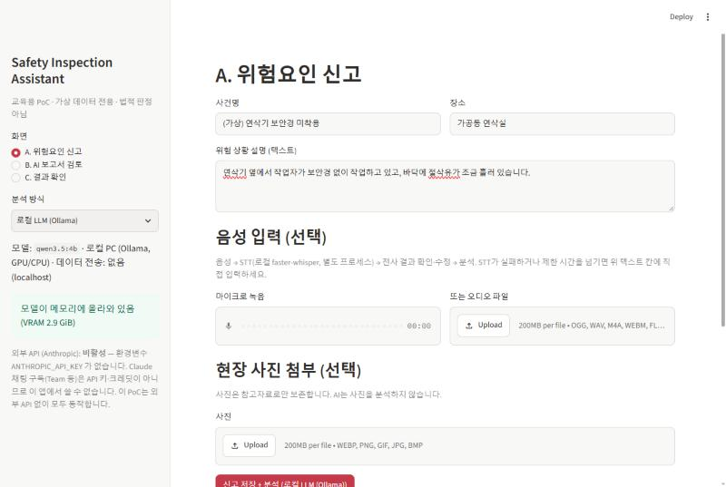
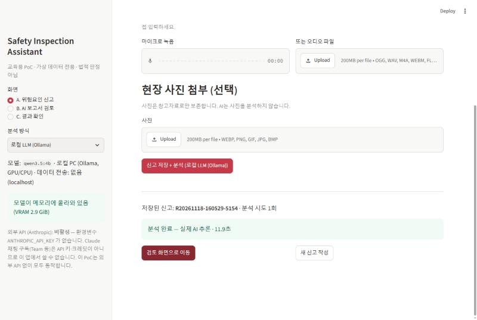
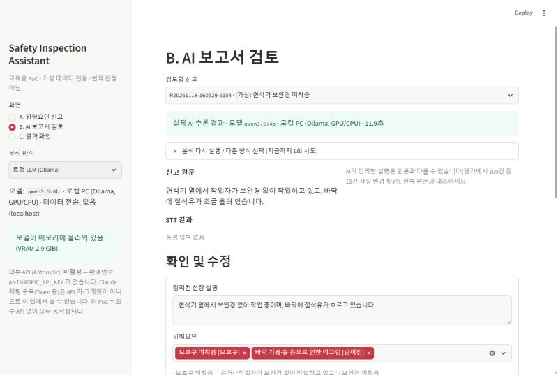
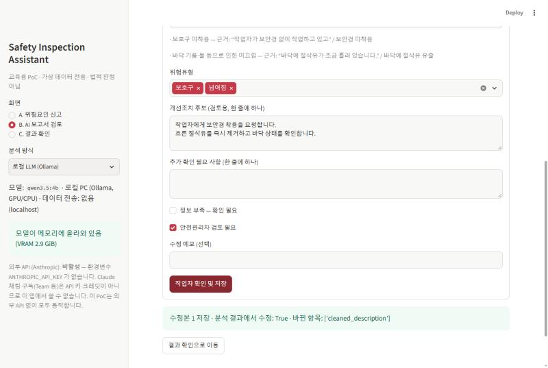
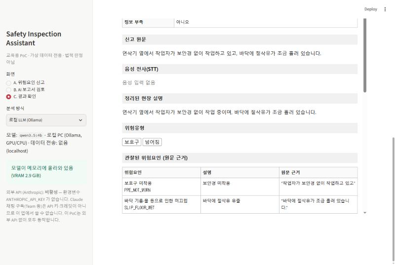
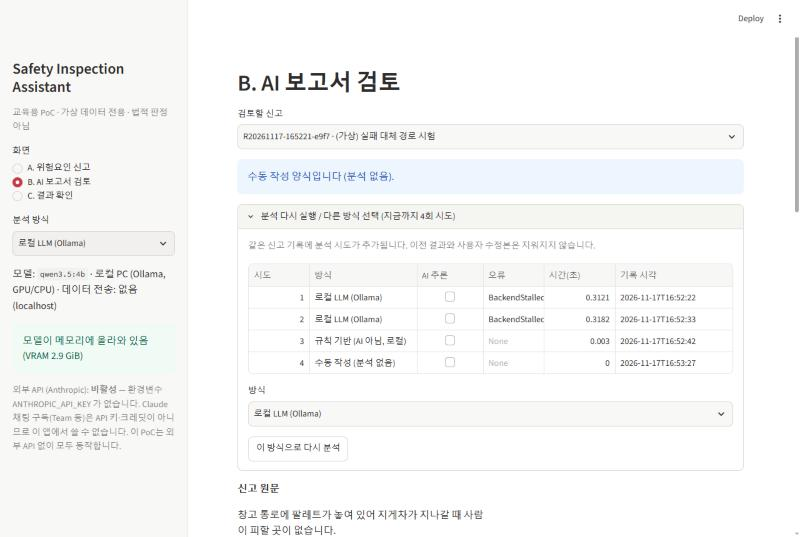

# Safety Inspection Assistant — 현장 위험요인 신고서 초안 작성 PoC

> **Main Quest 2 「내 도메인에서 AI로 개선 지점 찾아서 PoC 만들기」 제출 저장소입니다.**
>
> - 이 README 하나로 평가 문항 1~5 의 핵심을 확인할 수 있게 정리했습니다. 상세 근거는 링크한 문서에 있습니다.
> - **가상 데이터만** 씁니다. 특정 기업·개인·실제 사업과 무관합니다.
> - 결과는 위험요인 분류의 일관성을 확인하기 위한 것이며 **법적 적합성 판정이 아닙니다.**

### 평가 문항별 위치와 상태

| 평가 문항 | README 위치 | 상태 |
|---|---|---|
| 1. 개선 지점 정의 (문제·가설·사용자·성공 기준) | [2](#2-현재-업무-문제-개선-가설-대상-사용자), [3](#3-사전-성공-기준과-설정-근거-한계) | 작성함. 성공 기준의 근거(현행 수준)는 **미측정** |
| 2. 문제에 맞는 모델 선정 | [4](#4-ai-모델-선정-이유와-다른-후보-비교) | 음성인식(Whisper) + 텍스트 생성(LLM 구조화 출력). 실제 측정한 LLM 은 1종 |
| 3. 모델 실행 + PoC 완성 | [5](#5-poc-구현-구조와-실제-동작-흐름), [6](#6-실제-프로그램-화면) | 입력 → AI → 검토 → 보고서 흐름 동작 확인. 데이터는 **가상 사례와 합성 음성** |
| 4. 개선 효과 검증 | [7](#7-정량정성-검증-결과), [8](#8-기존-방식과-비교한-효과와-아직-검증하지-못한-부분) | 규칙 기반 기준선과 정량 비교함. **수작업과의 비교는 미실시** |
| 5. 한계와 추가 시도 | [9](#9-실패-사례와-후속-개선-계획) | 실패 사례 정리, 다중 모델 파이프라인, 실패 시 대체 경로, 실제 공개 자료(SIF) 후속 조사 |

---

## 1. 프로젝트와 도메인 소개

**도메인: 제조 현장의 안전점검·위험요인 신고 업무**

- 작업자는 현장에서 위험(바닥 기름, 배전반 앞 적치물, 보호구 미착용 등)을 발견하면 말이나 짧은 글로 알립니다.
- 안전관리자는 이를 받아 위험유형·위험요인·개선조치를 정리한 신고서·보고서로 다시 작성합니다.
- 작성자가 이 업무 방식을 직접 겪었습니다. 근무처는 밝히지 않습니다.

**이 PoC 가 하는 일**

작업자가 **텍스트 또는 음성**으로 신고하면 AI 가 다음 항목을 구조화한 **최초 위험요인 신고서 초안**을 만듭니다.

- 정리된 현장 설명
- 위험유형
- 관찰된 위험요인(원문 근거 포함)
- 개선조치 후보
- 확인 필요 사항

작업자가 확인·수정해 저장하고, 신고서(HTML, 인쇄 시 PDF)를 출력합니다.

- AI 결과와 사람 수정본은 따로 보존합니다.
- 사진은 첨부·보존만 하고 **AI 가 분석하지 않습니다.**

## 2. 현재 업무 문제, 개선 가설, 대상 사용자

| 항목 | 내용 |
|---|---|
| 현재 방식 | 작업자의 구두·짧은 글 신고 → 안전관리자가 다시 읽고 위험유형·위험요인·개선조치를 정해 양식에 맞춰 재작성 |
| 문제 | ① 같은 내용을 양식에 맞춰 다시 쓰는 반복 작업 ② 재작성 과정에서 정보 누락·표현 차이 ③ 모호한 신고("뭔가 새는 것 같아요")를 확인 없이 확정하기 쉬움 |
| 업무 유형 | 교안 4유형 중 **입력과 전사**(말·글 → 양식) + **분류와 배분**(위험유형 분류) |
| 개선 가설 | 신고 직후 AI 가 초안(구조화 항목 + 원문 근거 + 확인 필요 사항)을 만들고 사람이 확인·수정하면, 재작성 부담이 줄고 누락이 "확인 필요"로 드러난다 |
| AI 를 넣는 단계 | **초안 작성 단계에만** 넣습니다. 최종 판단은 작업자 확인과 안전관리자 검토가 합니다. 위험을 놓치면 조치가 늦어질 수 있는, 틀렸을 때 영향이 큰 업무이기 때문입니다 |
| 대상 사용자 | ① **현장 작업자**: 말로 신고하고 초안을 확인 ② **안전관리자**: 구조화된 초안을 받아 검토 (재작성 부담 감소 기대) |

> 문제와 현재 방식은 작성자 경험에 기반합니다. **업무 발생량(하루·주당 신고 건수)과 재작성 시간은 재지 않았습니다.**

### 업무 개선의 궁극적인 목적과 이번 PoC 의 검증 범위

현장의 위험요인 신고는 발견자가 사무실로 돌아가 구두로 전달하거나 별도의 양식에 내용을 입력해야 하는 등의 불편이 발생할 수 있다. 또한 안전관리자는 전달받은 비정형 정보를 다시 확인하고 정리하여 보고서로 작성해야 한다.

본 시스템의 궁극적인 목적은 현장에서 위험을 발견한 시점부터 신고 접수와 서류 작성까지 이어지는 과정을 간소화하는 것이다. 이를 위해 음성 및 사진 입력과 AI 기반 신고서 초안 생성 기능을 설계하였다.

다만 이번 PoC 에서는 전체 업무시간 단축이나 실제 모바일 사용성을 검증하지 않았다. 우선 AI 가 비정형 신고를 구조화하면서 핵심 위험요인을 정확히 분류하고 원문 사실관계를 보존할 수 있는지를 가상 신고 사례 100건(음성 경로는 합성 음성 10건)으로 검증하였다.

실험 결과, 로컬 LLM 의 구조화 정확도와 사실 보존 성능이 사전 목표에 미달하였다. 같은 자료에서 규칙 기반 분류는 정확도 목표를 넘었으나, 규칙과 사례를 같은 작성자가 만들어 과대평가되었을 가능성이 있다. 따라서 현 단계에서는 AI 결과의 사람 검토가 필수이며, 실제 업무 간소화 효과는 실제 현장 신고 자료와 후속 사용성 평가를 통해 확인해야 한다.

후보 업무 3개(신고기록 정리 / TBM 회의록 / 안전보건 자료 검색)를 비교하고 이 업무를 고른 이유는 [PoC_REPORT.md 1~2장](PoC_REPORT.md)에 있습니다.

## 3. 사전 성공 기준과 설정 근거, 한계

모델을 돌리기 전에 정한 기준입니다.

| # | 기준 | 목표 | 설정 근거 |
|---|---|---|---|
| S1 | 가상 사례 | 100건 (어려운 사례 20건: 복합·모호·부정문·정보 부족) | 교안: 담당자가 어렵다고 말하는 사례를 섞어야 후보 간 차이가 드러남 |
| S2 | 위험유형과 핵심 위험요인이 **모두** 사전 정답과 일치 | **100건 중 90건 이상** | 초기 PoC 설계 때 정한 **잠정 목표**. 현행 수작업 수준이나 통계에서 계산한 값이 아니며, 90 이어야 하는 실증 근거는 없음 |
| S3 | 원문에 없는 사실을 추가한 사례 | **0건** | 교안: 입력·전사 오류는 그럴듯해 보여 알아채기 가장 어려움. 신고 기록 왜곡은 조치 판단을 바꿈 |
| S4 | 정보 부족 시 | 확정하지 않고 "확인 필요" 표시 | 교안: 확신이 낮은 건은 사람에게 넘김 |
| S5 | 기록 | 입력·출력·근거·오류를 모두 기록 | 재현성 |
| S6 | 측정 설계 | 처리 시간과 사용자 수정 여부를 잴 수 있게 | 개선 효과 검증 준비 |

**한계**

- 과제는 "무엇이 얼마나 좋아지면 성공인가"의 근거로 지금 사람이 하는 수준을 요구합니다. 이번에는 **현행 수작업의 정확도와 시간을 재지 않았습니다.** 그래서 90 이 높은 기준인지 낮은 기준인지 판단할 수 없습니다.
- 실험 후 찾은 공개 연구에서는 서술문을 분류하는 훈련 코더의 정확도가 항목에 따라 47.6~80.0% 였습니다(미국 노동통계국, 2014). 아차사고 서술문 코더 간 일치는 79% 이상이었습니다(Taylor 외, 2014). 사람도 이 일을 완벽히 하지 못한다는 **보조 근거**일 뿐이며, 90% 의 근거가 아닙니다.
- 사례와 정답은 모델 실행 **전에** SHA-256 해시로 고정해 커밋했습니다(`7c22328`). 다만 이 기준 문서는 실험 후에 저장소에 들어갔습니다. 상세는 [PoC_REPORT.md 3장](PoC_REPORT.md)에 있습니다.

## 4. AI 모델 선정 이유와 다른 후보 비교

모듈에서 배운 기법 중 **음성인식(STT)**과 **텍스트 생성(LLM 구조화 출력)**을 골랐습니다. 신고는 말이나 짧은 글로 들어오고, 결과는 정해진 양식 항목이어야 하기 때문입니다.

교안 순서대로 **실행 위치와 라이선스로 먼저 거른 뒤** 비교했습니다. 신고에는 사업장·위치 정보가 섞일 수 있어 로컬 실행을 기본으로 두었습니다.

| 후보 | 역할 | 실행 위치 | 라이선스·데이터 | 실행 | 판단 |
|---|---|---|---|---|---|
| **Qwen3.5 4B** (Ollama, Q4_K_M, 온도 0, JSON 스키마 강제) | 구조화 출력 | 로컬 GPU (RTX 2070 SUPER 8GB) | Apache-2.0, 외부 전송 없음 | ✅ 100건 × 2회 | **선정**: 8GB GPU 에서 동작, 한국어 지원, 상업 이용 가능, 스키마 강제 출력 |
| 규칙 기반 분류기 (키워드 정규식 + 부정 표현) | 기준선 (AI 아님) | 로컬 | 자체 코드 | ✅ 100건 | 비교 기준선 |
| Claude Haiku 5.5 (Anthropic API) | 구조화 출력 | 외부 클라우드 | 상용 약관, 원문 외부 전송 | ❌ 미실행 (API 키·크레딧 없음) | 외부 전송이 허용될 때만 쓰는 선택지로 코드만 둠 |
| **faster-whisper + Whisper `small`** | 음성인식 | 로컬 (이 PC 는 CPU int8) | MIT / MIT | ✅ 합성 음성 10건 | **선정**: 로컬 실행, 시스템 ffmpeg 불필요, 한국어 지원 |
| openai-whisper (PyTorch) | 음성인식 | 로컬 | MIT | ❌ | 제외: 설치 부담 |
| 외부 STT API | 음성인식 | 외부 | 상용 약관 | ❌ | **실행 위치로 제외**: 음성이 외부로 나감 |
| 현행 수작업 | 기준선 | — | — | ❌ **미측정** | — |

- 후보 선정 단계에서 점수·순위는 매기지 않았습니다.
- 실험 후에 외부 무료 AI(OpenCode Zen, Gemini API 무료 등급, OpenRouter 무료 모델)의 공식 문서를 따로 조사했습니다. 결과는 [PoC_REPORT.md 4.1절](PoC_REPORT.md)에 있습니다. 실행하지 않았고 순위도 없습니다.
- 상세: [docs/technology_selection.md](docs/technology_selection.md)

## 5. PoC 구현 구조와 실제 동작 흐름

```
[입력]                       [AI 처리]                                  [출력]
텍스트 ─────────────┐
                    ├─▶ 작업자 확인 ─▶ 분석 엔진 ──────────────────▶ 구조화 초안 ─▶ 작업자 검토·수정 ─▶ 신고서 HTML/PDF
음성 ─▶ STT(로컬) ──┘   (전사문 수정)   ├ 로컬 LLM (기본, JSON 스키마)   (원문 근거·확인 필요)   (수정본 따로 저장)
사진 ─▶ 첨부·보존만 (AI 미분석)        ├ 규칙 기반 (대체)
                                        └ 수동 작성 (대체)
```

**실제 동작 흐름 (화면에서 확인함)**

1. **신고 저장 + 분석**: 원본(텍스트·전사문·사진·음성)을 **먼저 저장**하고 분석합니다. 같은 입력으로 다시 누르면 새 신고를 만들지 않고 같은 기록을 다시 분석합니다.
2. **AI 처리**
   - 로컬 LLM 이 JSON 스키마에 맞춰 출력합니다. 위험요인마다 **원문 근거 인용**이 붙습니다.
   - 근거가 원문에 실제로 있는지, 원문에 없는 부상·법령 용어가 들어갔는지 자동 검사합니다.
   - 설명이 없으면(사진만 있으면) 추론하지 않고 "확인 필요"로 둡니다.
3. **실패 대응**: LLM 이 멈추면(첫 응답 60초, 조각 사이 20초, 전체 90초 감시) 같은 기록에서 [다시 시도 / 규칙 기반 / 수동 작성]을 고를 수 있습니다. 실패를 포함한 모든 시도가 기록됩니다.
4. **검토·수정**: 원문과 AI 정리문을 나란히 보여 줍니다. 수정본은 AI 결과와 별도로 쌓이고, 바뀐 항목이 기록됩니다.
5. **결과**: 신고서 HTML 을 저장·내려받기 합니다(브라우저 인쇄 → PDF).

**코드 위치**

| 역할 | 파일 |
|---|---|
| 화면 | `app.py` |
| 분석 엔진 | `safety_assistant/engine.py` |
| LLM | `llm_engine.py` |
| 규칙 기반 | `rule_engine.py` |
| STT | `stt.py` |
| 저장 | `storage.py` |
| 신고서 | `report.py` |
| 자동 검사 | `checks.py` |

설정값은 `config/settings.yaml` 과 `config/taxonomy.yaml` 에 있고, 코드에 고정하지 않았습니다.

## 6. 실제 프로그램 화면

가상 신고 문장으로 2026-11-18 에 로컬에서 실행한 화면입니다.

| 화면 | 설명 |
|---|---|
|  | **A. 신고**: 텍스트 입력, 음성(마이크·파일) 입력, 사진 첨부. 사이드바에 로컬 모델 상태와 외부 API 비활성 사유 표시 |
|  | 신고 저장 + 로컬 LLM 분석 완료 (실제 AI 추론 11.9초, 모델을 미리 불러온 상태) |
|  | **B. 검토**: 왼쪽 신고 원문, 아래 AI 정리문. 원문 "조금 흘러 있습니다"가 AI 정리문에서 "흐르고 있습니다"로 바뀐 사례가 보임 (아래 7.3 의 사실 변경 유형) |
|  | 작업자가 정리문을 원문대로 고쳐 저장. "수정본 1 · 바뀐 항목: cleaned_description" 기록 |
|  | **C. 결과**: 수정본이 반영된 신고서. 위험요인마다 원문 근거 표시 |
|  | 실패 대체 경로: 같은 신고 1건에 시도 4회(LLM 멈춤 ×2 → 규칙 기반 → 수동 작성). 강제 실패 시험(2026-11-17) 기록 |

## 7. 정량·정성 검증 결과

### 7.1 성공 기준 대비 (가상 사례 100건, 사전 정답 고정)

| 기준 | 목표 | 규칙 기반 | 로컬 LLM 최초 | 로컬 LLM 설정 변경 후 |
|---|---|---|---|---|
| S2 정답 일치 | ≥ 90/100 | **92/100** | **80/100 (미달)** | **79/100 (미달)** |
| S3 원문에 없는 사실 추가 (사전 정의) | 0건 | 0건 (원문을 고쳐 쓰지 않음) | **5건 (미달)** — 수동 검토 | 수동 검토 미실시 |
| (참고, 사후 확장 집계) 사실관계 왜곡 전체 | — | 0건 | 18건 = 추가 5 + 추측을 단정으로 6 + 다른 사실로 치환 7 | 수동 검토 미실시 |
| S4 정보 부족 표시 | 9/9 | 9/9 (과잉 4) | 6/9 (과잉 3) | 6/9 (과잉 4) |
| 어려운 20건 정답 일치 | — | 19/20 | 11/20 | 10/20 |
| 평균 처리 시간 | — | 0.0003초/건 | 5.59초/건 | 4.58초/건 |

- 실행 폴더
  - 규칙 기반: `runs/20261117-142640_rule`
  - LLM 최초: `runs/20261117-142651_ollama`
  - LLM 설정 변경 후: `runs/20261117-165902_ollama`
- 각 폴더의 `summary.json` 에 반올림하지 않은 원시값이 있습니다.

**해석**

- **규칙 기반 92/100 은 과대평가일 가능성이 큽니다.** 규칙과 사례를 같은 사람이 썼습니다. 실패는 키워드 방식의 전형적 약점이었습니다("전자레**인지**"를 불확실 표현으로 오인, "덮개"를 기계 방호덮개로 오분류, 부정문 오판).
- **로컬 LLM 은 S2·S3 모두 미달**입니다. 복합 위험 6건 중 1건만 맞혔고, 위험유형을 자기 위험요인 코드와 다르게 낸 경우가 7건이었습니다.
- 설정 변경(컨텍스트 4096, 출력 상한, 스트리밍)은 2026-11-17 화면 장애를 고치면서 했습니다. 정답 일치가 달라진 사례는 1건(C090)이며, 설정 때문인지 우연인지는 구분할 수 없습니다.
- 평균 시간이 줄어든 데에는 `localhost` 이름 해석 지연(요청당 약 2초) 제거가 포함돼 있습니다.

### 7.2 음성(STT) 경로 — 합성 음성 10건 (**실제 녹음 아님**)

| 측정 | 값 |
|---|---|
| 문자 오류율(CER, 전체) | 0.0518 |
| 전사문을 고치지 않고 분석했을 때 원문 분석과 같은 결과 | 8/10 |
| 처리 | 오디오 66.1초 → 전사 62.2초 (CPU) |

- 오류는 숫자·설비 번호("2라인"→"이 라인")와 현장 용어("절삭유"→"절사 규")에 몰렸습니다.
- 결과가 바뀐 2건은 글자는 같고 띄어쓰기만 달랐습니다. LLM 이 사소한 표기 차이에 민감하다는 뜻입니다.
- Windows TTS 로 만든 음성이라 잡음·사투리가 없어, 실제 현장보다 좋게 나왔을 가능성이 큽니다.
- 실행 폴더: `runs/20261117-165625_stt_ollama`

### 7.3 정성 검증 — 사실관계 왜곡 사례 (S3)

- 정리문 100건을 원문과 대조했습니다. 자동 검사는 아래 사례를 **하나도** 잡지 못했습니다.
- **지표 구분**
  - **S3(사전 정의: 원문에 없는 사실 추가)에 해당하는 것은 5건**입니다. 목표 0건에 미달합니다.
  - 검토 과정에서 "추측을 단정으로 바꿈"(6건)과 "다른 사실로 바꿈"(7건)도 함께 찾았습니다. 이 두 유형은 S3 의 사전 정의에 명시돼 있지 않았으므로, **사후에 확장한 "사실관계 왜곡" 집계(합계 18건)**로 따로 적습니다. S3 기준을 소급해 바꾸지 않았습니다.
- **검토자는 코딩 에이전트**이며 사람 전문가가 아닙니다. 사람 검토로 다시 확인해야 합니다. 상세: [docs/manual_fabrication_review.md](docs/manual_fabrication_review.md)

| 유형 | 건수 | 원문 → AI 정리문 |
|---|---|---|
| 없는 사실 추가 (**S3 해당**) | 5 | "물인지 약품인지 모르겠습니다" → "바닥에 물이 젖어 있습니다" (약품 가능성 삭제) |
| 추측을 단정으로 | 6 | "소화기가 안 보입니다" → "설치되어 있지 않음을 확인했습니다" |
| 다른 사실로 바꿈 | 7 | 열린 시너 통 "두 개" → "1개" |

6장 3번 화면의 "조금 흘러 있습니다 → 흐르고 있습니다"도 같은 경향입니다. 그래서 이 PoC 는 **원문과 AI 정리문을 나란히 보여 주고, 작업자가 확인한 수정본만 신고서에 반영**하도록 만들었습니다.

### 7.4 수작업 기준선

**미측정입니다.** 같은 사례를 사람이 처리할 때의 시간·정확도를 재지 않았습니다. 채점 도구(`scripts/score_human.py`)만 준비돼 있습니다.

## 8. 기존 방식과 비교한 효과와 아직 검증하지 못한 부분

| 비교 | 결과 | 근거 |
|---|---|---|
| AI vs **규칙 기반**(단순 자동화) | 이번 가상 자료에서는 **규칙 기반이 더 정확**했음 (92 vs 80·79). 단 규칙 쪽은 작성자 편향 가능성 | 7.1 [실측] |
| AI vs **현행 수작업** (정확도) | **비교 못 함** | 수작업 미측정 |
| AI vs **현행 수작업** (시간) | **비교 못 함.** AI 처리 시간(건당 약 4.6~5.6초)만 쟀고, 사람의 재작성 시간은 재지 않음. **시간 단축 효과를 주장하지 않습니다** | 7.1 [실측] / 미측정 |
| 정성: 원문 vs AI 초안 vs 작업자 수정본 | AI 초안은 구조(위험유형·근거·확인 필요)를 채워 주지만, 정리문에서 사실이 바뀌는 경우가 있어 **사람 확인 없이는 쓸 수 없음** | 6장 화면, 7.3 |

**지금 말할 수 있는 것**

- 입력 → AI → 사람 확인 → 신고서 흐름은 동작합니다.
- AI 가 실패해도 신고는 이어집니다.
- AI 결과를 그대로 신고서로 쓰면 안 된다는 점을 숫자로 확인했습니다: 사실 추가 5건(S3), 사실관계 왜곡 전체 18건(사후 확장 집계, 코딩 에이전트 검토).

**아직 검증하지 못한 것**

- 수작업 대비 시간·정확도
- 실제 현장 신고 문장과 실제 녹음에서의 성능
- 외부 LLM 등 다른 모델과의 비교
- 하루·주당 업무 발생량

## 9. 실패 사례와 후속 개선 계획

**주요 실패 사례**

| 구분 | 사례 |
|---|---|
| LLM | 복합 위험 누락 (C085 가스 냄새·바닥 물 누락), 가스 ↔ 화학물질 혼동 (C047, C049, C075), 부정문 정상 보고를 위험으로 오판 (C092), 정리문 사실관계 왜곡 18건 (그중 S3 의 사실 추가 5건) |
| 규칙 기반 | "전자레인지"의 "인지"를 불확실 표현으로 오인 (C010, C050), 분전반 커버를 기계 덮개로 오분류 (C008) |
| STT | 숫자·현장 용어 오인식. 띄어쓰기 차이로 LLM 결과가 바뀜 (C048, C087) |
| 운영 (2026-11-17) | cuBLAS 없는 PC 에서 STT 가 두 번째 호출에 멈춤 → Ollama 180초 시간 초과로 번짐. 원인을 재현해 고침. 기록: [docs/incident_2026-11-17.md](docs/incident_2026-11-17.md) |

**후속 조사에서 발견한 한계 (기존 100건 평가와 별개)**

- 실제 공개 자료인 안전보건공단 「사망사고 고위험요인(SIF) 아카이브」의 제조업 1,546건을 검토했습니다. 현재 위험요인 코드 24개로 직접 대응되는 사례는 **224건(14.5%)**이었습니다.
  - 이 수치는 **작성자 1인이 만든 대응표 초안**에서 나온 **잠정 결과**입니다.
  - **사망·중대재해 자료**에 대한 분석이므로, 일상적인 위험 신고 전체에서의 포괄률을 뜻하지 않습니다.
- 정지·전원차단 없이 정비, 적재물 무너짐, 작업차량 동선처럼 **작업 방법·절차에서 생기는 위험**이 현재 분류체계에는 없습니다. 분류체계 자체가 실제 산업재해를 충분히 포괄하지 못한다는 뜻입니다.
- SIF 는 **사고 후 서술문**이라 작업자의 사고 전 신고와는 다른 자료입니다. 이 분석은 모델을 돌린 성능 평가가 아니라 자료·라벨 구조 검토입니다.
- 상세: [docs/sif_data_review.md](docs/sif_data_review.md), 분류체계 재설계 검토: [docs/taxonomy_design.md](docs/taxonomy_design.md)

**후속 개선 계획**

1. **현행 수준 실측**: 사람 2명 이상이 같은 20건을 처리해 정확도·시간을 재고, 그 값으로 성공 기준을 다시 정해 실험 전에 커밋합니다.
2. **실제 데이터**
   - 작성자 경험 기반의 실제 말투 신고문과 본인 녹음 음성을 추가합니다. 실제 사업장·인물 정보는 넣지 않습니다.
   - SIF 자료로 분류체계 포괄률과 분류 정확도를 따로 잽니다.
3. **사실 변경 줄이기**: 문장 정리를 빼고 원문을 유지하는 구성과 비교합니다. 불확실 표현이 사라졌는지 자동 검사를 추가합니다.
4. **분류체계 확장**: 공식 분류(국내 발생형태·기인물, SIF 고위험작업 등)를 참조하는 다축 구조를 검토합니다([docs/taxonomy_design.md](docs/taxonomy_design.md)). 기존 100건 실험과 독립된 후속 실험으로 시험합니다.
5. **다른 모델 비교**: 성격이 다른 로컬 모델이나 외부 모델을 같은 100건으로 비교합니다. 외부 전송은 가상 데이터에 한해, 승인 후 진행합니다.

## 10. 실행 환경, 설치, 실행·재현 명령어

**확인한 환경**

| 항목 | 값 |
|---|---|
| OS | Windows 10 |
| Python | 3.11.9 |
| GPU | NVIDIA RTX 2070 SUPER 8GB (LLM 용. STT 는 CPU) |
| Ollama | 0.40.16, 모델 `qwen3.5:4b` (약 3.3GB) |
| 외부 API | 키 없음 |

GPU 가 없어도 Ollama 는 CPU 로 동작할 수 있으나 느립니다(이 환경에서는 측정하지 않음).

**설치**

1. Python 3.11 을 설치합니다(설치 때 "Add python.exe to PATH" 체크).
2. 이 폴더에서 PowerShell 을 엽니다.

```bash
python -m venv .venv
```
```bash
.venv\Scripts\python.exe -m pip install -r requirements.txt
```

3. (선택, 로컬 LLM) [Ollama](https://ollama.com) 를 설치한 뒤 모델을 받습니다. Ollama 가 없어도 규칙 기반 분석·수동 작성·저장·신고서 출력은 모두 동작합니다.

```bash
ollama pull qwen3.5:4b
```

4. (선택, 외부 API — 기본값 아님) 외부 전송이 허용되고 **유료 API 키·크레딧이 있을 때만** 환경변수로 넣습니다. 키를 파일에 저장하지 마세요.
   - Claude 채팅 구독(Pro·Team 등)은 API 키가 아니어서 쓸 수 없습니다.
   - 키가 없으면 화면 목록에 외부 API 가 나타나지 않습니다.

```bash
$env:ANTHROPIC_API_KEY = "<본인 키>"
```

**프로그램 실행** (브라우저에서 `http://localhost:8501`)

```bash
.venv\Scripts\python.exe -m streamlit run app.py
```

- 첫 음성 전사 때 Whisper `small` 가중치(약 460MB)를 한 번 내려받아 `models/` 에 둡니다. 오디오는 외부로 나가지 않습니다.
- 신고 기록은 `records/<사건ID>/` 에 저장되며 git 에 올리지 않습니다.

**평가 재현** (실행마다 `runs/<시각>_<방식>/` 새 폴더, 덮어쓰지 않음. 시작 시 정답 해시를 확인하고 다르면 중단)

```bash
.venv\Scripts\python.exe scripts\run_eval.py --method rule
```
```bash
.venv\Scripts\python.exe scripts\run_eval.py --method ollama
```
```bash
.venv\Scripts\python.exe scripts\make_test_audio.py
```
```bash
.venv\Scripts\python.exe scripts\eval_stt.py --method ollama
```
```bash
.venv\Scripts\python.exe scripts\compare_runs.py runs\20261117-142640_rule runs\20261117-142651_ollama
```
```bash
.venv\Scripts\python.exe -m unittest discover -s tests -v
```

**재현성 주의**

- 규칙 기반은 같은 입력에 항상 같은 결과를 냅니다.
- LLM 은 온도 0 이어도 설정·버전이 바뀌면 결과가 달라질 수 있습니다(실제로 설정 변경 후 80 → 79).
- 실행 폴더의 `run_config.json`, `settings_snapshot.yaml`, `prompt_used.md` 에 당시 조건이 남아 있습니다.
- `make_test_audio.py` 는 Windows 한국어 TTS 음성(Heami)이 필요합니다.

## 11. 상세 보고서와 실험 결과 파일

| 문서·파일 | 내용 |
|---|---|
| [PoC_REPORT.md](PoC_REPORT.md) | **상세 실험 보고서**: 후보 업무 비교, 선정 이유, 성공 기준 근거, 모델 후보, 실험 설계, 결과, 구축 판단, 회고, 교안 요구사항 체크표 |
| [docs/technology_selection.md](docs/technology_selection.md) | 기술 후보·실행 위치·라이선스 검토 |
| [docs/manual_fabrication_review.md](docs/manual_fabrication_review.md) | 사실관계 왜곡 18건(사실 추가 5 / 추측→단정 6 / 사실 치환 7) 사례별 검토 |
| [docs/incident_2026-11-17.md](docs/incident_2026-11-17.md) | STT 멈춤·Ollama 시간 초과 원인 조사와 수정, 화면 검증 기록 |
| [docs/sif_data_review.md](docs/sif_data_review.md) | 공개 자료(SIF 아카이브) 구조 검토와 평가 설계 (후속 조사) |
| [docs/taxonomy_design.md](docs/taxonomy_design.md) | 공식 분류체계 조사와 다축 분류 구조 설계, 변경 영향 분석 (후속 설계, 미구현) |
| `runs/20261117-142640_rule/` | 규칙 기반 100건 결과 |
| `runs/20261117-142651_ollama/` | 로컬 LLM 최초 100건 결과 |
| `runs/20261117-165902_ollama/` | 로컬 LLM 설정 변경 후 100건 결과 |
| `runs/20261117-165625_stt_ollama/` | STT 합성 음성 10건 결과 |
| `runs/20261117-143615_comparison.md` | 규칙 기반 vs LLM 최초 비교표 |
| `data/cases.jsonl`, `data/gold.jsonl`, `data/GOLD_LOCK.json` | 입력 100건, 사전 정답, 정답 해시 |

**프로젝트 구조 (요약)**

```
app.py                  Streamlit 화면 (신고 / 검토 / 결과)
safety_assistant/       분석 엔진, LLM·규칙·STT, 저장, 신고서, 자동 검사
config/                 설정값과 분류체계 (코드에 고정하지 않음)
prompts/system_v1.md    LLM 시스템 프롬프트
scripts/                데이터 생성, 평가, STT 평가, 비교, 사람 기준선 채점
data/                   가상 사례·정답·합성 음성
runs/                   실험 결과 (덮어쓰지 않음)
docs/                   상세 문서와 화면 캡처
tests/                  AI 없이 도는 기본 테스트
```

## 보안·공개 조건

- 실제 회사 자료, 실제 인물 정보, 실제 창업 프로젝트 정보를 넣지 않았습니다. 사례 100건은 모두 가상입니다.
- API 키는 환경변수로만 읽고 저장소에 없습니다. 기본 분석은 로컬입니다.
- 외부 공개 자료(SIF) 원본은 이용조건(공공누리 제3유형 표기) 확인 전까지 저장소에 넣지 않습니다(`external_data/` 제외).
